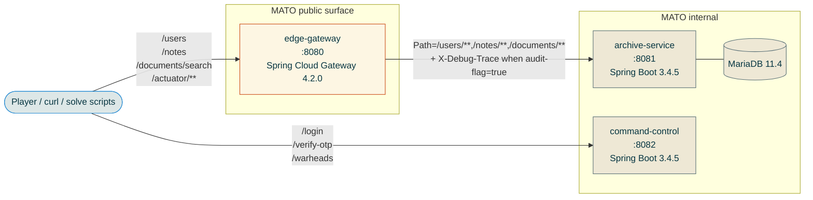
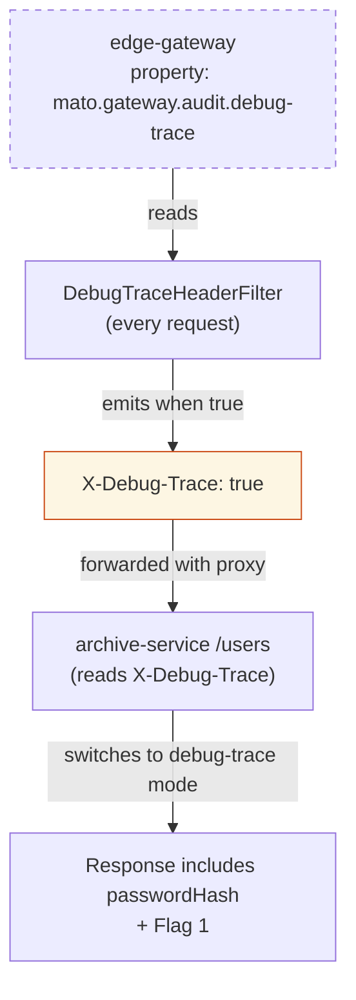

# Architecture

## Service map

`command-control` is reachable from the player only because port 8082 is host-published in `docker-compose.yml`. In a more locked-down deployment it would be reachable only after the player has discovered the URL inside the special-ops document — which is the in-fiction story the CTF tells.

## Inter-service contract

| Caller | Callee | Path | Auth | Headers gateway adds |
|---|---|---|---|---|
| Player | edge-gateway | `/users` | none | — |
| Player | edge-gateway | `/notes` | HTTP Basic | — |
| Player | edge-gateway | `/documents/search` | HTTP Basic | — |
| Player | edge-gateway | `/actuator/gateway/**`, `/actuator/refresh`, `/actuator/env` | none (CTF misconfig) | — |
| edge-gateway | archive-service | `/users`, `/notes/**`, `/documents/**` | passes Basic through | `X-Debug-Trace: true` (only when `mato.gateway.audit.debug-trace=true`) |
| Player | command-control | `/login` | none | — |
| Player | command-control | `/verify-otp` | none | — |
| Player | command-control | `/warheads` | `Authorization: Bearer <jwt>` | — |
| archive-service | MariaDB | JDBC | DB credentials | — |

The gateway never calls `command-control`. Discovery of `command-control` is part of the puzzle — its URL is leaked from the special-ops document inside `archive-service` after the SQL-injection step.

## Trust model

Three trust links matter:

1. **`edge-gateway` trusts its own `Environment`.** The `DebugTraceHeaderFilter` reads the audit-trace flag fresh on every request — so a runtime mutation of the underlying property source flips the header on the very next request. CVE-2025-41243 exploits this by mutating `@systemProperties` from outside, via SpEL injection into the gateway actuator.
2. **`archive-service` trusts `X-Debug-Trace` blindly.** No signature, no allowlist of upstream IPs, no "trusted proxy" token. Whatever the gateway forwards, archive-service believes. This is the load-bearing weakness that makes the audit flip useful.
3. **`command-control` is standalone.** It trusts its own JWT signing key and its own user store (single user: `mr.president`). It does not trust the gateway, and the gateway does not call it.

## Service inventory

### edge-gateway

| Field | Value |
|---|---|
| Port | 8080 (host-published) |
| Package root | `org.mato.edge` |
| Framework | Spring Cloud Gateway 4.2.0 (WebFlux) |
| Endpoints | `/actuator/{gateway,refresh,env,health,info,mappings}`, plus the proxied paths `/users/**`, `/notes/**`, `/documents/**` |
| Java classes | `GatewayApplication`, `AuditTraceInitializer`, `DebugTraceHeaderFilter` |
| CVE | [CVE-2025-41243](https://spring.io/security/cve-2025-41243) — SpEL injection via `/actuator/gateway/routes` |

The `AuditTraceInitializer` runs on startup and seeds the audit-trace flag (`mato.gateway.audit.debug-trace`) into `System.getProperties()`. That placement is what makes the canonical SpEL exploit work: the payload `#{@systemProperties['mato.gateway.audit.debug-trace']='true'}` writes through `BeanResolver` + `Indexer`, both of which the restrictive `PropertyAccessor` does **not** gate. See [`docs/notes.md`](notes.md) for the deeper walkthrough.

### archive-service

| Field | Value |
|---|---|
| Port | 8081 (internal-only, never published to host) |
| Package root | `org.mato.archive` |
| Framework | Spring Boot 3.4.5 (WebMVC), Spring Security 6.4.4, Spring AI 1.0.3 |
| Endpoints | `GET /users`, `GET /notes`, `POST /documents/search` |
| Java classes | `ArchiveApplication`, `user.User{,Repository,Controller}`, `note.Note{,Repository,Controller}`, `document.Document{,Repository,Controller}`, `security.{ArchiveUserDetailsService,SecurityConfig}`, `seed.Seeder` |
| CVE | [CVE-2026-22730](https://spring.io/security/cve-2026-22730) — Spring AI MariaDB SQL injection in `MariaDBFilterExpressionConverter` |

`/users` is the only endpoint that branches on `X-Debug-Trace`. `/notes` and `/documents/search` require HTTP Basic and are unaffected by the audit-trace flag — they're protected by Spring Security's user-details lookup against the seeded user table.

### command-control

| Field | Value |
|---|---|
| Port | 8082 (host-published — but discovery URL is leaked through the SQL-injection stage) |
| Package root | `org.mato.command` |
| Framework | Spring Boot 3.4.5 (WebMVC), Spring Security 6.4.4, jjwt 0.12.6 |
| Endpoints | `POST /login`, `POST /verify-otp`, `GET /warheads` |
| Java classes | `CommandApplication`, `login.LoginController`, `otp.{OtpService,OtpController}`, `warhead.WarheadController`, `jwt.JwtService`, `security.SecurityConfig` |
| CVE | [CVE-2025-22234](https://spring.io/security/cve-2025-22234) — BCrypt timing leak (response-time username enumeration) |

Single in-memory user (`mr.president`) plus a 4-digit OTP rotated every 30 seconds and a 30-second JWT TTL. The window-pressure pacing is intentional.

### MariaDB

`infra/mariadb/init/01-schema.sql` contains the schema bootstrap. Hibernate's `ddl-auto: update` tops it up at archive-service startup, then `Seeder.java` populates rows.

## Configuration surface

### edge-gateway (`services/edge-gateway/src/main/resources/application.yml`)

| Property / env | Default | What it does |
|---|---|---|
| `ARCHIVE_URI` | `http://archive-service:8081` | Downstream target for the proxied routes |
| `MATO_GATEWAY_AUDIT_DEBUG_TRACE` | `false` | Initial value of the audit-trace flag (CVE target) |
| `spring.cloud.gateway.restrictive-property-accessor.enabled` | `true` | Default; not load-bearing for our payload (see notes.md) |
| `management.endpoints.web.exposure.include` | `gateway,health,info,refresh,env,mappings` | The exposure misconfig — required by the CTF |
| `management.endpoint.gateway.access` | `unrestricted` | Required in Spring Boot 3.4 to expose POST/DELETE on `/actuator/gateway/routes` |

### archive-service (`services/archive-service/src/main/resources/application.yml`)

| Property / env | Default | What it does |
|---|---|---|
| `SPRING_DATASOURCE_URL` | `jdbc:mariadb://localhost:3306/sctp` | DB connection string |
| `FLAG_1`, `FLAG_2`, `FLAG_3` | placeholder | Flag values injected at runtime by docker-compose |
| `WEAK_USER_PASSWORD` | `sunshine` | Password seeded for `bob` (the BCrypt crack target) |
| `COMMAND_URL` | `http://command-control:8082` | URL embedded in the special-ops document |
| `COMMAND_PRESIDENT_PASSWORD` | (compose default) | The president's password, base64'd into the special-ops doc |

### command-control (`services/command-control/src/main/resources/application.yml`)

| Property / env | Default | What it does |
|---|---|---|
| `JWT_SECRET` | (compose default) | HMAC-SHA256 signing key for issued JWTs |
| `JWT_TTL_SECONDS` | `30` | Window between OTP success and `/warheads` lockout |
| `OTP_SEED` | (compose default) | HMAC seed for the 4-digit TOTP-style OTP |
| `OTP_WINDOW_SECONDS` | `30` | OTP rotation period |
| `PRESIDENT_PASSWORD` | (compose default) | Password for the single seeded user `mr.president` |
| `FLAG_4` | placeholder | Final flag, returned by `GET /warheads` |
